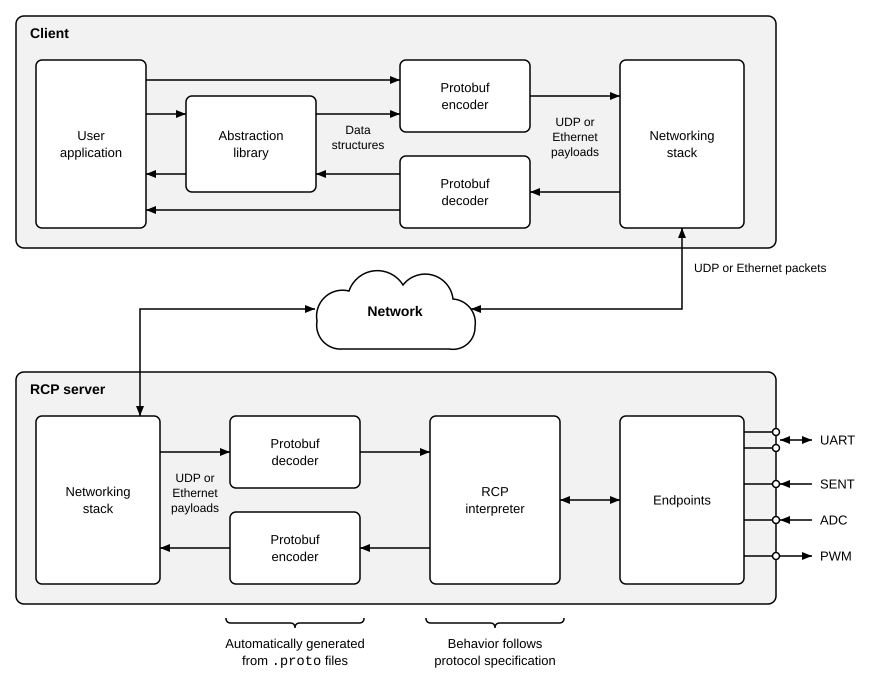

# Operating principle

The client builds a directive, usually through an abstraction library, encodes it with code that a Protocol Buffers (protobuf) compiler generated from the `.proto` files, and sends it through its networking stack. The RCP server decodes the directive, executes its operations on the endpoints, and answers with a report. It also sends reports that the client has not requested, e.g., when a scheduled action has run. The figure shows both sides. The RCP interpreter of the server contains no application logic.

[Messages](02_messages.md) describes the messages, [Network](03_network.md) their transport, and [Scheduler](04_scheduler.md) how the server runs actions. The encoding is explained in [Protobuf encoding](07_protobuf.md) and the code generators in [Code generators](08_generators.md).

## Endpoints

An endpoint is a hardware block of the server that exchanges low-level data with the outside world, e.g., a SPI controller, a GPIO controller, or a UART. The figure shows a UART, a SENT receiver, an ADC, and a PWM generator as examples. Each type of [endpoint](../protocol/endpoints/readme.md) has a page of its own.

Each endpoint has a unique, non-zero handle, which a client uses to address it. The handle 0 addresses the server itself. The optional query `rcp.dev.qryInterfaces` lists the endpoints with their handles and types, see [Identification and Capabilities](../protocol/server/rcp_info.proto).
