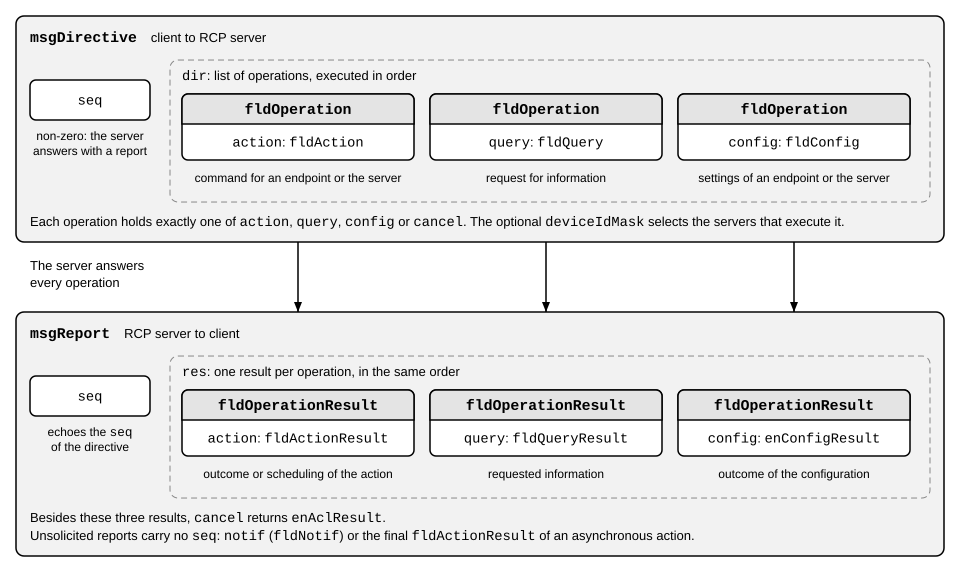

# Messages

The client and the RCP server exchange two types of top-level messages, the directive and the report. They are defined in [RCP Messages](../protocol/rcp.proto). The page [Network](03_network.md) specifies how they are transmitted. The figure shows the structure of both messages.



## Directives

A directive (`msgDirective`) holds a sequence number (`msgDirective.seq`) and a list of operations. The server handles the operations in the order in which they appear. It checks and schedules an asynchronous action at its position, and the action runs when its trigger fires, see [Scheduler](04_scheduler.md).

A directive is not a transaction. An operation error neither rolls back earlier operations nor prevents later operations from being handled. This differs from a decoding error, which rejects the whole directive, see Malformed messages.

The maximum size of a message, see [Network](03_network.md), and the size of the operations limit the number of operations in a directive. A server may limit this number further.

An operation (`fldOperation`) is one of the following:

- An action commands an endpoint or the RCP server itself, e.g., a SPI transfer or the toggling of GPIO pins. It can run immediately, at a later time, repeatedly, or when an event occurs, see [Scheduler](04_scheduler.md).
- A query requests information, e.g., the identity, the configuration, or the status. The enumeration `rcp.dev.enQuery` marks the mandatory and the optional queries.
- A configuration changes the settings of the RCP server or of an endpoint.
- A cancel operation cancels scheduled actions that have not completed.

An action, a configuration, or a query contains the handle of the endpoint that it addresses, followed by the message for that endpoint. The message matches the type of the endpoint at the handle, see [Operating principle](01_principle.md).

If `msgDirective.seq` is non-zero, the server returns it in the report to the directive. If it is 0, the default, the server sends no report to the directive. This does not suppress unsolicited reports. A malformed directive is the exception, see Malformed messages. The sequence number correlates a reply, not an execution: receiving the same directive again can execute its operations again.

If a directive is broadcast or multicast to many RCP servers, the optional DID mask of an operation (`fldOperation.deviceIdMask`) selects the servers that execute it. A server executes the operation only if the bitwise AND of its identification number (DID) and the mask is not zero. Otherwise, it ignores the operation and adds no result for it to the report. The DID is set with `rcp.core.fldServerConfig.did`. See [Core Operations](../protocol/server/rcp_core.proto) for an example.

## Reports

A report (`msgReport`) holds the sequence number of the directive that it answers and one result for each of its operations, in the same order, except for an operation that the server ignores because of the DID mask. Each kind of result has its own enumeration of result codes. Some result codes are warnings. A warning means that the operation succeeded but deviated from the request. For example, `cfgParamAdjusted` tells that the server accepted a configuration but adjusted a value, such as a clock speed that its hardware cannot reproduce exactly. The client can read the actual setting back with a query. A warning counts as success, e.g., for the reply mode of an action and for the trigger type of a dependent action, see [Scheduler](04_scheduler.md).

## Unsolicited reports

The server also sends reports that the client has not requested. These reports carry no `msgReport.seq`. A report can hold results of two kinds:

- The result of a scheduled action. If an action does not run immediately, the report to its directive only acknowledges that the action is pending. The server reports the result of each execution, unless `fldAction.replyMode` limits the reports.
- A notification. Some endpoints produce data on their own, e.g., when a GPIO pin changes, a UART receives bytes, or an ADC crosses a threshold.

Action execution results are sent to the client that scheduled the action. Each endpoint has at most one client that owns its notifications, and sends them only to that client. The query result `fldEndpointNotifInfo` identifies the owner.

To save bandwidth, the server may collect several notifications in one report, see [Core Operations](../protocol/server/rcp_core.proto). Each endpoint numbers its notifications (`fldNotif.seq`) and each action its results (`fldActionResult.seq`), so a gap shows that a report is missing.

## Malformed messages

A server ignores a frame that is not a valid RCP frame, see [Network](03_network.md). It sends no report for it.

If the frame is valid but the server cannot process the encoded message, it rejects the whole directive. It does not execute any operation of the directive, not even the operations in front of the error. The server answers with a report that holds one notification. The code of the notification (`fldNotif.code`) tells the reason:

- `ntfProtocolError`: the message is not valid Protocol Buffers data, e.g., it ends inside a field or contains an invalid wire type.
- `ntfProtocolTooLarge`: the message exceeds a limit of the server, e.g., a list has more items than the server can store. The limits are implementation-specific.
- `ntfProtocolUnsupported`: the message contains a field that the server does not know, or it sets more than one member of a `oneof`.
- `ntfOutOfMemory`: the server ran out of memory while it decoded the message.

The report carries the sequence number of the directive only if the server read it before it detected the error. Otherwise, the sequence number is 0. The server sends the report also if the sequence number of the directive is 0.

## Compatibility

New versions of the schema add fields, messages, and enumeration values. They never renumber an existing field or enumeration value and never reuse a number for another purpose, so a message of an older version is still valid in a newer version. A client reads the version of the protocol that a server implements from `rcp.info.fldIdentity.rcpVersion`.

A client and a server can implement different versions, so a receiver can get content that it does not know:

- A server rejects a directive that contains a field that it does not know, see Malformed messages. It does not skip the field and execute the rest of the directive.
- A client skips a field of a report that it does not know. Protocol Buffers libraries do this by default.
- A server answers an operation that it does not implement with the result code `actNotSupported`, `cfgNotSupported`, or `qryNotSupported`.

## Example

A directive with two operations: a query for the status of the RCP server and an action that reads the state of the pins 0 and 1 of the GPIO endpoint with the handle 1. Both run as soon as possible:

```text
seq: 7
dir { query { rcp: qryServerStatus } }
dir { action { hndl: 1  gpio { get: 0x03 } } }
```

The report has the same sequence number and one result for each operation, in the same order. In this example, the power-on flag of the RCP server is still set, pin 0 is high, and pin 1 is low:

```text
seq: 7
res { query { rcp { server { pwrOn: true } } } }
res { action { gpio: 1 } }
```

The examples use the text format of protobuf, see [Protobuf encoding](07_protobuf.md).
