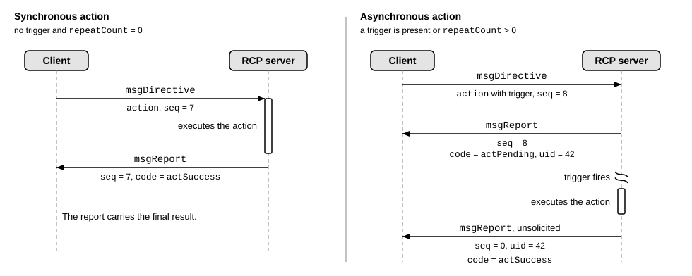
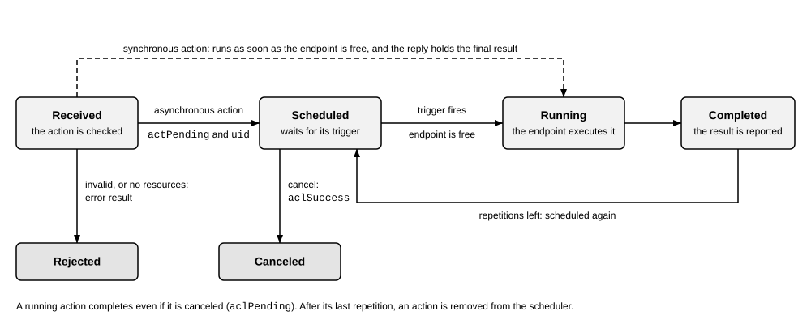
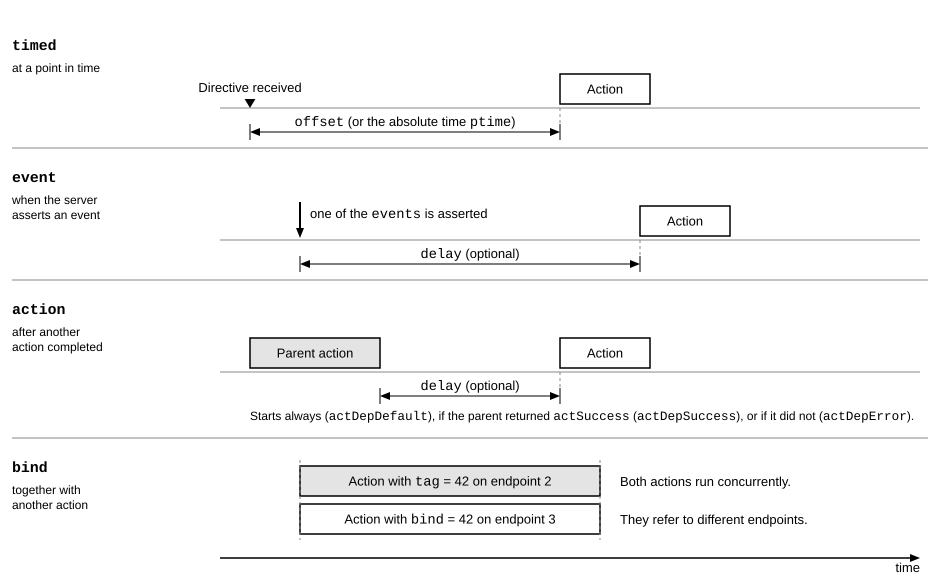
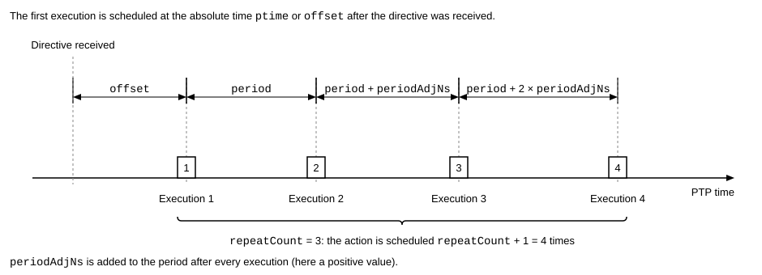

# Scheduler

The scheduler is the part of an RCP server that decides when an action runs. A client can request that an action runs at a given time, repeatedly, when an event occurs, or when another action has finished. The server keeps the action in its scheduler until it is due, runs it, and reports the result. The messages are defined in [RCP Messages](../protocol/rcp.proto).

## Synchronous and asynchronous actions

An action without a trigger and with `fldAction.repeatCount` equal to 0 is synchronous. The server executes it as soon as the endpoint is free, and the report to the directive holds the final result. Every other action is asynchronous, including one with an empty `timed` message. The report to the directive acknowledges scheduling (`actPending`), not execution. Execution results follow in unsolicited reports, subject to `fldAction.replyMode`. The figure shows both cases.



If a client sets `rcp.core.fldServerConfig.syncActionsEnable` to false, the server treats synchronous actions as asynchronous. It answers with `actPending` and runs the action as soon as the endpoint is free.

## Life of an action

The server first checks an action. It rejects an invalid action with an error result. Examples are an invalid parameter (`actInvalidParam`), a command that the endpoint does not support (`actNotSupported`), and a scheduler with no room left (`actNoResources`). Otherwise, it schedules an asynchronous action, which then waits for its trigger. When the trigger fires and the endpoint is free, the action runs and the server reports its result. A repeating action is scheduled again. After the last repetition, the server removes the action.

An endpoint executes one action at a time. An action that is due while its endpoint is busy waits, unless it has a hard deadline, see Late actions. Actions for different endpoints can run at the same time. The figure shows the states of an action.



## Triggers

The trigger of an action (`fldAction.trigger`) decides when the action runs. An action without a trigger runs as soon as the endpoint is free (best effort).



- A timed action (`fldActionTimed`) is due at its presentation time. It is either an absolute time (`fldActionTimed.ptime`) or an offset from the reception of the directive (`fldActionTimed.offset`). If neither is given, the action is due at once.
- An event action (`fldActionEvent`) runs when the server asserts one of the listed events, optionally after a delay. Examples are the change of a GPIO pin and the crossing of an ADC threshold. The events and their numbers are implementation-specific.
- A dependent action (`fldActionDependent`) runs when another action has finished, optionally after a delay. The trigger type selects whether the action runs after any result of the other action, only after a success, or only after an error.
- A bound action (`fldAction.bind`) runs together with another action, e.g., to start a PWM and a SPI controller together. A bound action addresses a different endpoint than the action it is bound to. Otherwise, the server rejects it.

## Repetition

The field `fldAction.repeatCount` is the number of repetitions, so the action runs `repeatCount` plus one times. The value 0xFFFFFFFF repeats the action until it is canceled. A repeating action is always asynchronous.

For a timed action, `fldActionTimed.period` sets the interval of the repetitions. The server adds the period to the presentation time of the previous execution, so a delay of one execution does not shift the following ones. After each execution, the server adds the signed number of nanoseconds in `fldActionTimed.periodAdjNs` to the period. This makes sequences that become faster or slower. The figure shows an example.



## Time base

Timed actions use a timer of the server as their time base. The Precision Time Protocol (PTP) synchronizes the timer with the time of the network, see [PTP](../protocol/server/rcp_ptp.proto). Servers that follow the same time master can run actions at the same time. The client can also set the timer with `rcp.dev.opSetPtpTime`, e.g., before it uses timed actions or enables PTP. The precision and the granularity of the timer are implementation-specific.

## Late actions

An action is late if the server cannot run it at its presentation time, because that time is already in the past or because the endpoint is busy. The field `fldActionTimed.hardDeadline` decides what happens to a late action:

- If it is `false`, the default, the server runs the action anyway. A successful execution returns the warning `actDelayed`. A failed execution returns its error instead.
- If it is `true`, the server does not run the action. The result is the error `actTooLate`.

The result of an action can carry the time at which it ran (`fldActionResult.time`).

## Results and replies

The field `fldAction.replyMode` filters the execution results of an asynchronous action: every execution, none, errors only, the last execution only, or errors and the last execution. It does not suppress the scheduling acknowledgement. The directive's `msgDirective.seq` independently controls that report, see [Messages](02_messages.md). A synchronous action ignores `replyMode`.

Warnings count as success, both for reply filtering and for dependent triggers. In particular, `actDelayed` triggers `actDepSuccess`, not `actDepError`, and does not by itself produce an `actReplyOnError` report.

## Identifying and canceling actions

An action has two identifiers:

- The tag (`fldAction.tag`) is a label that the client chooses. It does not have to be unique, so several actions can share it. The client knows the tag in advance, e.g., to name the action in the trigger of another one. In a trigger, the tag 0 refers to the action that the server queued last, and a tag that several actions share refers to the first one found. The server returns the tag with every result.
- The unique ID (`fldActionResult.uid`) is generated by the server for every queued action and identifies exactly one action. The client learns it from the acknowledgement.

The cancel operation (`fldActionCancel`) selects actions by one of them. A unique ID selects one action, and a tag selects all live actions that carry it. An action is live while it is scheduled or running. The result is `aclSuccess` if a scheduled action is removed, `aclPending` if the action was already running and completes, and `aclNotFound` if no live action matches. The command `rcp.dev.opCancelAllActions` clears all scheduled actions, including those with repetitions left. A running action completes.

When an action is removed, dependents still waiting for its completion are removed without a notification or an action result. An already-triggered dependent, including one waiting out its delay, finishes its current execution under its reply mode, with no further repetitions.

The query `rcp.dev.qrySchedulerStatus` lists the actions that the scheduler holds (`rcp.core.fldSchedulerStatus`) with their IDs, tags, endpoints, remaining repetitions, and clients. The capacity of the scheduler is implementation-specific. If it is full, the server rejects a new asynchronous action with `actNoResources`.

The settings `fldAction.failsafe` and `fldAction.storeToNvm` are described on the page [Higher-level behavior](05_behavior.md).

## Example

The first operation of this directive sets GPIO pin 0, which is configured as an output, one second after the reception of the directive. The action has a hard deadline, so the server drops it if it is late, and it has the tag 7. The second operation clears the pin 10 ms after the first action has succeeded and names the first action by its tag. Both actions are asynchronous. The server answers each with `actPending` and reports the results later.

```text
seq: 10
dir {
   action {
      hndl: 1
      gpio { set: 0x01 }
      timed { offset { sec: 1 }  hardDeadline: true }
      tag: 7
   }
}
dir {
   action {
      hndl: 1
      gpio { clr: 0x01 }
      action {
         tag: 7
         trigType: actDepSuccess
         delay { nsec: 10000000 }
      }
   }
}
```

The next directive cancels all actions with the tag 7 and then reads what the scheduler still holds:

```text
seq: 11
dir { cancel { tag: 7 } }
dir { query { rcp: qrySchedulerStatus } }
```
