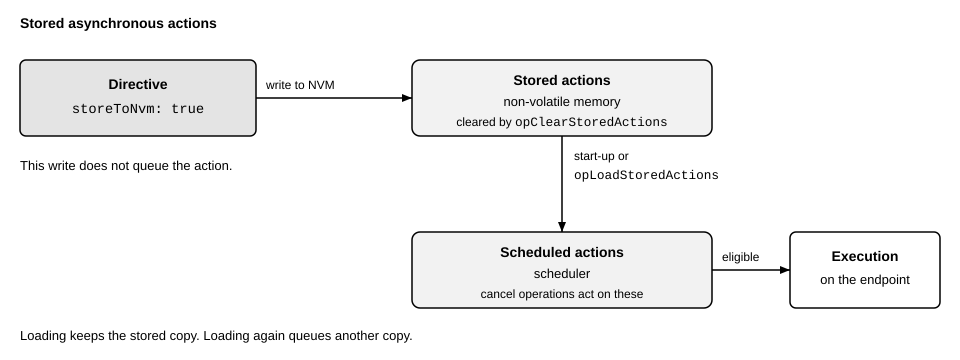

# Higher-level behavior

This page describes behavior that spans more than one message: persistent storage and fail-safe operation.

## Persistent storage

An RCP server can have a non-volatile memory (NVM), e.g., an EEPROM. The query `rcp.dev.qryNvmStatus` tells whether it is present. An operation that needs the NVM fails with the result `actNvmNotPresent` on a server without it. The NVM holds the configuration, actions, and user data.

### Configuration

The command `rcp.dev.opSaveConfig` saves the current configuration of the server. The configuration includes the network settings, such as the MAC address and the multicast addresses, and the registered clients.

At start-up, the server loads the saved configuration if there is a valid one. Otherwise, or without an NVM, it starts with its default configuration, so a change that is not saved is lost at a reset. A saved configuration that cannot be loaded, e.g., because its checksum does not match, is not applied. The status of the NVM reports the error (`rcp.core.fldNvmStatus.configError`).

The command `rcp.dev.opRestoreConfig` loads the saved configuration at any time. If it returns an error, the current configuration does not change. The command `rcp.dev.opRestoreFactoryConfig` erases the NVM and restarts the server with its default configuration.

The power-on flag of the status (`rcp.core.fldServerStatus.pwrOn`) is set at every start until the client clears it with `rcp.dev.opClearPwron`. A client that clears the flag once and polls it later can detect an unwanted reset.

### Actions

An action whose field `fldAction.storeToNvm` is set is written to the NVM instead of being scheduled. The server loads the stored actions at start-up, so they run even if no client has reached the server yet. This allows fail-safe actions that exist from power-up.



The command `rcp.dev.opLoadStoredActions` loads the stored actions at once. It does not remove the actions that are already loaded, so repeating it loads them again. The command `rcp.dev.opClearStoredActions` erases the stored actions, but not the loaded ones. The status of the NVM tells how many actions are stored and whether loading them failed (`rcp.core.fldNvmStatus`).

To receive reports from stored actions after a restart, register their client and save the client configuration, see [Network Configuration](../protocol/server/rcp_net.proto).

### User data

The NVM can also hold user data, which the server does not interpret. The command `rcp.dev.opManageUserData` reads or writes it (`rcp.core.fldNvmOperation`). The server rejects an access beyond the user-dedicated NVM.

## Fail-safe operation

The network watchdog detects the loss of the client, see [Core Operations](../protocol/server/rcp_core.proto). If it expires, the server enters the fail-safe mode and executes the fail-safe actions. These are the actions with the field `fldAction.failsafe` set. An example is an action that brings an output into a safe state. The client defines the fail-safe actions after the start of the server, or the server loads them from the NVM, see above. The server may also enter the mode for other implementation-specific reasons.

In fail-safe mode, the server rejects a synchronous action without the flag, and outside of the mode, it rejects a synchronous action with the flag. The result is `actFailsafeError` in both cases. An asynchronous fail-safe action waits in the scheduler until the server enters the mode.

What else the mode changes is implementation-specific, e.g., whether the server cancels the other scheduled actions and whether the PTP timer keeps running. The same holds for the way in which the server leaves the mode. The flag `rcp.core.fldServerStatus.liv` is set during normal operation and cleared in fail-safe mode. The command `rcp.dev.opEnterFailsafe` forces the mode. It can be used to test the fail-safe actions.

## Example

The following directive enables and saves a one-second watchdog timeout, stores a fail-safe action, and loads it for use now. It also survives a restart. In fail-safe mode, the action toggles GPIO pin 0, already configured as an output, every 250 ms, e.g., to blink a lamp. Execution reports are suppressed.

```text
seq: 12
dir { config { rcp { server { watchdogTimeoutMs: 1000 } } } }
dir { action { rcp { op: opSaveConfig } } }
dir {
   action {
      hndl: 1
      gpio { tgl: 0x01 }
      timed { period { nsec: 250000000 } }
      repeatCount: 4294967295
      replyMode: actReplyNever
      failsafe: true
      storeToNvm: true
   }
}
dir { action { rcp { op: opLoadStoredActions } } }
```
